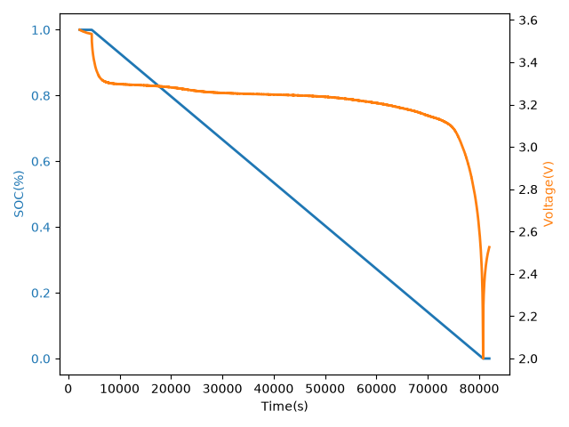
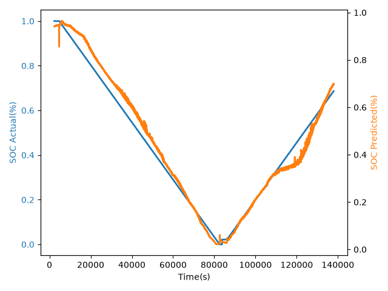

# Introduction

This project was created to find ML models that can accurately estimate the SOC(State of Charge) of a EV battery pack

# Dataset

For the project, the Calce A123 battery dataset was used

Key features are:
- Capacity of new battery is 1.1Ah

The dataset includes 2 types of test, the LC-OCV(Low Current Open Circuit Voltage) and the DPF(Dynamic Profile Files) which has FUDS and DST results

The experiment was started by using the 0 degree dataset.

## Shortcomings

### Flat Curve

The A123 battery uses the LiFePO4 chemistry. This battery type has a near flat voltage  curve from 20-80% SOC. Due to this, models have to be trained for different SOC at basically the same voltage and current values

### No SOH

The model cannot be trained on SOH, or be able to predict it as there is no data between each cycle. So SOH can only be measured for a dataset.
As the SOH practically remains the same within a cycle. Training a model on it will cause the SOH parameter to not be considered

# Basic Tests

The first model to be trained is a FNN. It was trained on the 0 degree LC-OCV dataset

### Data Separation

Training: Cell 007 LC-OCV 0 degree dataset
Validation: Cell 008 LC-OCV 0 degree dataset; Last 15% of samples
Testing: Cell 008 LC-OCV 0 degree dataset; First 85% of samples

The MAE is `2.6%`

The model is trained well for SOC < 30%. But other than that, it has errors, that is due to the flat curve of the dataset

# Citations

[1] Center for Advanced Life Cycle Engineering (CALCE), "CALCE Battery Data," University of Maryland, College Park, MD, USA. [Online]. Available: https://umd.edu
